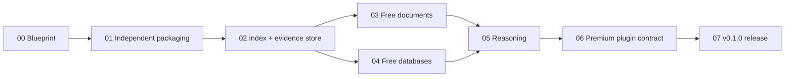

# Detailed v0.1.0 implementation plan — FROM SCRATCH

**No prior code.** Phase 00 validates architectural assumptions, not previous implementation. Phase 01 writes first production Python code. Later phases build on actual tested code from prior phases, not on fictional existing repositories.

| Phase | Outcome | Detailed plan | Copilot prompt |
|---|---|---|---|
| 00 | Greenfield design | [PHASE_00](phases/PHASE_00_ARCHITECTURE.md) | `00-architecture.prompt.md` |
| 01 | Core package and extension runtime | [PHASE_01](phases/PHASE_01_CORE_PACKAGING.md) | `01-core.prompt.md` |
| 02 | Persistent typed hierarchy/graph | [PHASE_02](phases/PHASE_02_INDEX_EVIDENCE.md) | `02-index.prompt.md` |
| 03 | Free document wheel | [PHASE_03](phases/PHASE_03_DOCUMENTS.md) | `03-documents.prompt.md` |
| 04 | Free database wheel | [PHASE_04](phases/PHASE_04_DATABASES.md) | `04-databases.prompt.md` |
| 05 | Bounded reasoning | [PHASE_05](phases/PHASE_05_REASONING.md) | `05-reasoning.prompt.md` |
| 06 | Premium mock and entitlements | [PHASE_06](phases/PHASE_06_COMMERCIAL_CONTRACT.md) | `06-commercial.prompt.md` |
| 07 | Ship candidate | [PHASE_07](phases/PHASE_07_RELEASE.md) | `07-release.prompt.md` |

## Phase execution
For every phase: read the plan → concise design → implement → test wheel installs → update docs → report acceptance individually → stop for review. Do not move to next phase on failed gates. No invented timelines or estimated development completion dates.

## After v0.1.0
See `docs/FUTURE_RELEASES.md` and `docs/EXTENSION_CATALOG.md` for future free/paid modules. The extension contract is prepared in v0.1.0; advanced production modules are NOT shipped in that version.
