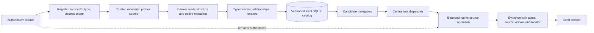
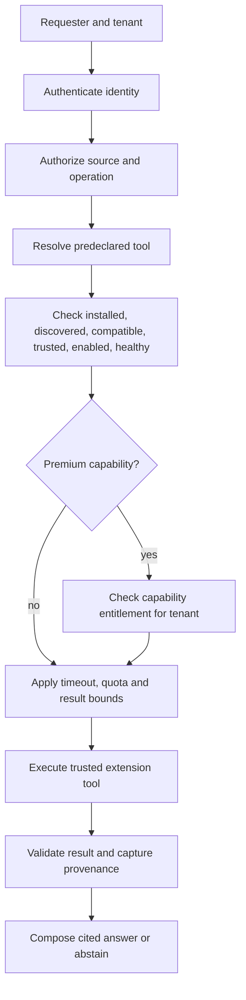
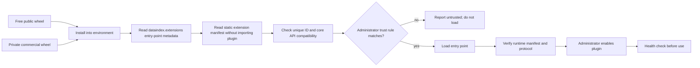
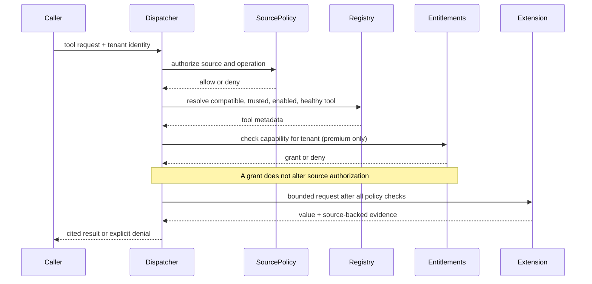

# DataIndex v0.1.0 — Greenfield architecture

This document describes the DataIndex v0.1 architecture.

## Boundaries and responsibilities

| Component | Responsibility | Explicit boundary |
|---|---|---|
| Client / SDK / CLI | Submit typed requests and render cited results | Never creates executable SQL or plugin code from model output |
| Source registry | Stable source ID, type, version/read marker and access policy reference | Does not copy or replace authoritative content |
| Indexer | Ask a compatible, trusted extension for typed index records | Indexes structure, metadata, relationships and native locators; not bulk source bodies |
| Catalog and graph | Persist versioned nodes, hierarchies, relationships and provenance | Does not treat summaries or inferred edges as primary evidence |
| Extension registry | Discover entry-point metadata; validate ID, API range, trust and enablement | Discovery is not import, trust or sandboxing |
| Tool dispatcher | Enforce identity, source authorization, plugin state, entitlement and budgets | Is the sole execution boundary for retrieval tools |
| Native extension | Read its source using bounded, deterministic operations | Cannot grant access, alter entitlement, or bypass dispatch |
| Optional planner | Select among predeclared schema-constrained tools | Cannot execute SQL, filesystem, network or Python supplied by an LLM |
| Evidence composer | Assemble results with source/version/locator/operation citations | Does not convert model-generated summaries into observed facts |

Core is a small Python distribution (`dataindex-core`, namespace `dataindex`) with
no extension, LLM-provider, database-driver, OCR, scientific or licensing-service
dependency at import time. SQLite is the local catalog store. Free and commercial
extensions are independent wheels implementing the same versioned contract.

## Source, index and evidence lifecycle

The index is a navigational cache, not a source-of-truth copy. A document source
version is a content revision/hash or provider revision; a live database operation
records the strongest available read timestamp or transaction marker. Re-indexing
creates/replaces a source-version snapshot transactionally; stale catalog entries
must not silently stand in for a newer source revision. Source-specific locators
remain native (for example, a Markdown heading anchor or a database table/query
locator). No fixed-token segmentation or embeddings are used.

## Retrieval lifecycle

The dispatcher checks source authorization and commercial entitlement separately.
An entitlement only permits a capability; it never grants access to a source. The
optional planner can request only registered tool IDs and their declared input
schemas. SQL uses pre-approved operations, bound parameters, source/table/column
allowlists, read-only credentials and configured limits.

## Installation and plugin lifecycle

Entry-point discovery is not a sandbox. Only explicitly trusted code may be loaded
in-process. Unknown, incompatible, duplicate, unhealthy or disabled plugins fail
independently and must not disable unrelated extensions. The static manifest is
packaged with the extension so core can check its declared ID, edition, API range,
capabilities and source types before importing the entry point; after loading,
the runtime manifest must match it.

## Commercial activation

For v0.1, the entitlement interface is provider-neutral and tested with a
deterministic fixture; it is not a billing or production license service. Hosted
deployments must enforce both checks server-side. Local checks are an operational
gate, not tamper-proof protection for proprietary code.

## Test/install matrix required by the design

| Environment | Required evidence |
|---|---|
| Core wheel only | Offline import, catalog and CLI work; no optional imports |
| Core + documents wheel | Markdown, TXT and HTML fixtures return native locators |
| Core + databases wheel | SQLite schema and approved bounded read operations work without driver extras; DuckDB and server engines work with their extras |
| Core + both free wheels | Reproducible mixed-source evidence path works |
| Core + synthetic premium wheel | Deny, grant and revoke are checked at execution |
| Remove one extension | Core and remaining extensions continue to work |
